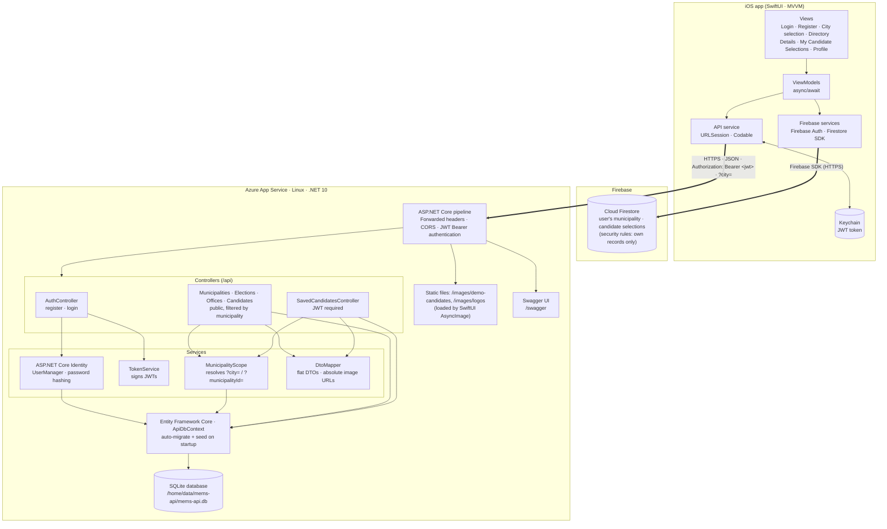
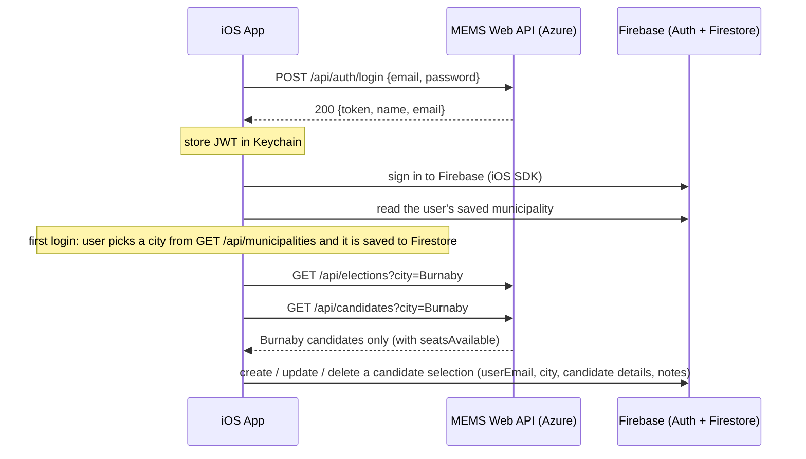
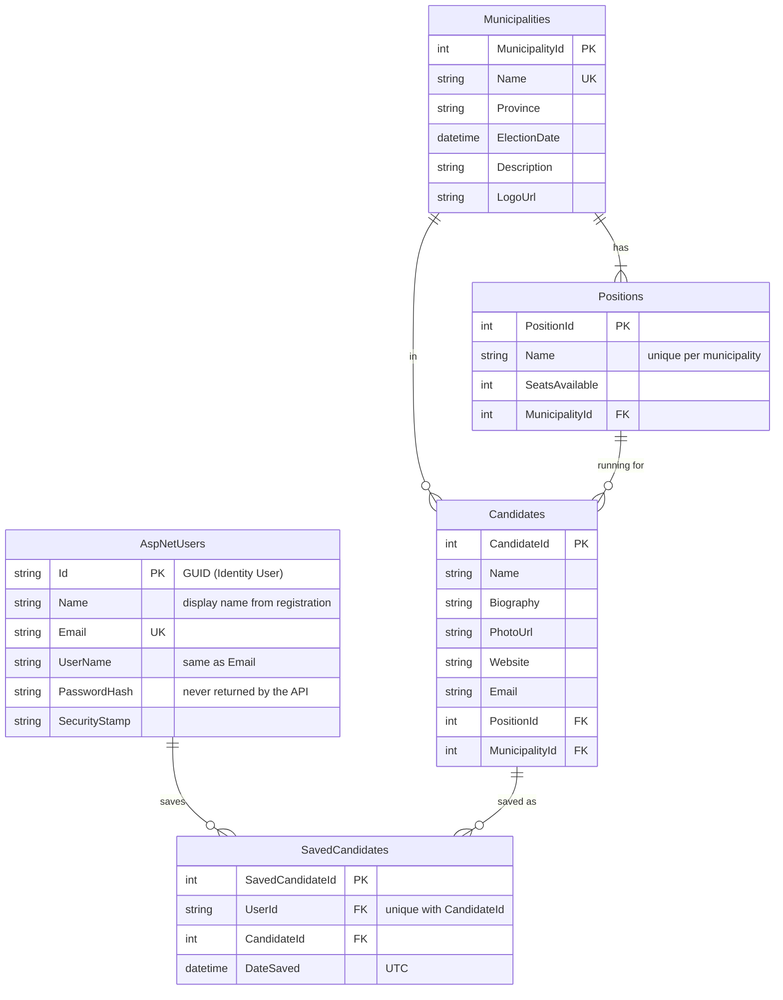

# Municipal Elections Companion — ASP.NET Core Web API

COMP4977 Assignment 2. This is the backend for the **Municipal Elections Companion** SwiftUI app. It provides user registration and login with JWT, plus municipal election data (municipalities, offices and candidates) filtered by the user's chosen municipality.

| Item | Value |
| --- | --- |
| Project | `src/Mems.Api` (ASP.NET Core Web API, .NET 10) |
| Tests | `tests/Mems.Api.Tests` (xUnit integration tests through the real HTTP pipeline, against SQLite) |
| Data | Entity Framework Core 10 Code-First, SQLite, ASP.NET Core Identity |
| Auth | JWT Bearer (HMAC-SHA256), 7-day tokens |
| Hosting | Azure App Service (Linux) |
| Azure API URL | https://mems-api-afisher-ane9a7cmfpb9b9at.canadacentral-01.azurewebsites.net |
| API explorer | Swagger UI at `/swagger` (the site root `/` redirects there) |

## Repository layout

| Path | Contents |
| --- | --- |
| `src/Mems.Api` | The Web API: controllers, EF Core model and migrations, seed data, candidate portraits and municipality logos (`wwwroot/images`) |
| `tests/Mems.Api.Tests` | Integration tests for every endpoint |
| `scripts/deploy-api-azure.sh` | One-command deployment of the API to Azure App Service with the Azure CLI |
| `src/Mems.Web`, `tests/Mems.Tests` | The partner team's ASP.NET Core MVC administration site, which the API's data model and fictional candidates are based on. It is not part of the mobile backend. |

## Changes in Assignment 2

- **Election data is filtered by municipality.** These endpoints now **require** the municipality:
  - `GET /api/candidates`
  - `/api/candidates/search`
  - `/api/positions`
  - `/api/offices`
  - `/api/elections`

  Give it as `?city={name}` (case-insensitive, e.g. `?city=Burnaby`) or `?municipalityId={id}`. These endpoints only ever return that municipality's records:
  - Without a municipality, they return `400`.
  - An unknown city returns `404`.
- **Single-item lookups can be filtered too.** `GET /api/candidates/{id}?city=` and `/api/positions/{id}?city=` return `404` for a record that belongs to a different municipality.
- **New endpoints.**
  - `GET /api/offices?city=` is the same as `/api/positions`, under the name the specification uses.
  - `GET /api/elections?city=` returns one municipality's election: its offices with seat counts, and the number of candidates.
- **Candidates include `seatsAvailable`.** This is how many candidates for that office a voter may choose, so the app can enforce selection limits (only one mayor, for example).
- **Seat limit on saved candidates (fix from Assignment 1).** `POST /api/savedcandidates` refuses a selection beyond the office's seat count with `409`. `GET /api/savedcandidates` accepts an optional `?city=`.
- **Candidate selections are stored in Firebase Firestore** by the iOS app, which signs the user in to Firebase itself. The `/api/savedcandidates` endpoints remain available, but the app no longer uses them.

---

## 1. Architecture



### Sign-in, municipality and selection flow



### Request pipeline (`Program.cs`)

1. **ForwardedHeaders.** App Service terminates TLS, so the app trusts `X-Forwarded-Proto`. Generated image URLs are therefore `https://…`, as iOS App Transport Security requires.
2. **Exception handler.** Unexpected errors return `{ "message": "An unexpected server error occurred." }` with status 500.
3. **Static files:** `/images/demo-candidates/*.jpg` and `/images/logos/*.png`.
4. **Swagger** and **Swagger UI**.
5. **CORS:** `AllowAnyOrigin`, `AllowAnyMethod`, `AllowAnyHeader`.
6. **Authentication** (JWT Bearer) and **Authorization**.
7. **Controllers.**
8. **Startup.** `Database.MigrateAsync()` and the idempotent seeder run before the first request. A new App Service needs no manual database commands.

---

## 2. Database ERD (Web API, SQLite)



`IdentityDbContext` also creates `AspNetRoles`, `AspNetUserClaims`, `AspNetUserLogins`, `AspNetUserRoles`, `AspNetUserTokens` and `AspNetRoleClaims`, but the API doesn't use them.

**Delete rules:**
- **Restrict** on Municipality → Position → Candidate, so election data can't be deleted while other rows depend on it.
- **Cascade** on User/Candidate → SavedCandidate.

**Seed data** (`Data/SeedData.cs`, inserted only when the database is empty):
- **4 municipalities:** Pitt Meadows, Maple Ridge, Burnaby and Surrey. Each has `Province = "BC"`, `ElectionDate = 2026-10-17` and a PNG logo.
- **12 offices:** each municipality has Mayor (1 seat), Councillor (6 seats) and School Trustee (2 seats).
- **24 fictional candidates:** six per municipality, two per office. Each has a biography, a portrait, a website and an email.

---

## 3. API endpoints

All responses are camelCase JSON. Every error, validation failures included, has the shape `{ "message": "…" }`. Image URLs are absolute, built from the request as `{scheme}://{host}/images/...`. To force a particular host, set the `App__PublicBaseUrl` setting.

| Method | Route | Auth | Success | Errors |
| --- | --- | --- | --- | --- |
| POST | `/api/auth/register` | public | 200 `{message}` | 400 |
| POST | `/api/auth/login` | public | 200 `{token, name, email}` | 400, 401 |
| GET | `/api/municipalities` | public | 200 `MunicipalityDto[]` (all, for choosing a city) | |
| GET | `/api/municipalities/{id}` | public | 200 `MunicipalityDto` | 404 |
| GET | `/api/elections?city={name}` | public | 200 `ElectionDto` | 400, 404 |
| GET | `/api/offices?city={name}` (same as `/api/positions`) | public | 200 `PositionDto[]` | 400, 404 |
| GET | `/api/offices/{id}[?city=]` (same as `/api/positions/{id}`) | public | 200 `PositionDto` | 404 |
| GET | `/api/candidates?city={name}[&positionId=]` | public | 200 `CandidateDto[]` | 400, 404 |
| GET | `/api/candidates/{id}[?city=]` | public | 200 `CandidateDto` | 404 |
| GET | `/api/candidates/search?city={name}&name={q}[&positionId=]` | public | 200 `CandidateDto[]` | 400, 404 |
| GET | `/api/savedcandidates[?city=]` | 🔒 Bearer | 200 `SavedCandidateDto[]` (newest first) | 401, 404 |
| GET | `/api/savedcandidates/{id}` | 🔒 Bearer | 200 `SavedCandidateDto` | 401, 404 |
| POST | `/api/savedcandidates` | 🔒 Bearer | 201 `SavedCandidateDto` | 400, 401, 404, 409 |
| DELETE | `/api/savedcandidates/{id}` | 🔒 Bearer | 204 No Content | 401, 404 |

Notes:

- **Municipality filtering.** Wherever `city` appears, `municipalityId={id}` works instead.
  - On the lists and on `/api/elections`, the municipality is required.
  - On the `{id}` lookups it's optional. When it's given, a record from another municipality returns `404`.
- **Search** does a case-insensitive partial match on the candidate name, within the chosen municipality. If `name` is missing or empty, it returns all of that municipality's candidates.
- **`positionId`** optionally narrows a candidate list to one office.
- **Saving a candidate.** `POST /api/savedcandidates` returns `409` if the candidate is already saved, or if the user already holds as many candidates for that office as it has seats.
- **Deleting a saved candidate.** `DELETE /api/savedcandidates/{id}` matches the user's entry by `SavedCandidateId`. If none matches, it falls back to matching by `CandidateId`.
- **Saved-candidate endpoints** only ever read or change the signed-in user's entries. The user is identified by the token's `sub` claim.

### Sample requests and responses

**`POST /api/auth/register`**

```json
// request
{ "name": "Jane Doe", "email": "jane@example.com", "password": "password123" }
// 200
{ "message": "Registration successful" }
// 400 (duplicate)
{ "message": "An account with this email already exists." }
// 400 (validation)
{ "message": "Enter a valid email address. Password must be at least 6 characters." }
```

**`POST /api/auth/login`**

```json
// request
{ "email": "jane@example.com", "password": "password123" }
// 200
{ "token": "eyJhbGciOiJIUzI1NiIsInR5cCI6IkpXVCJ9.eyJhdWQiOiJNZW1zSW9zQXBwIi…", "name": "Jane Doe", "email": "jane@example.com" }
// 401
{ "message": "Invalid email or password" }
```

The token's claims are:
- `sub`: user ID
- `email`
- `name`
- `jti`
- `iss`: `MemsApi`
- `aud`: `MemsIosApp`
- `exp`: 7 days after login

**`GET /api/municipalities`** (one item shown)

```json
[
  {
    "municipalityId": 3,
    "name": "Burnaby",
    "province": "BC",
    "electionDate": "2026-10-17T00:00:00",
    "description": "A large, diverse city at the centre of Metro Vancouver …",
    "logoUrl": "https://<host>/images/logos/burnaby.png"
  }
]
```

**`GET /api/elections?city=Pitt%20Meadows`**

```json
{
  "municipalityId": 1, "municipalityName": "Pitt Meadows", "province": "BC",
  "electionDate": "2026-10-17T00:00:00", "description": "A rural-urban community on the Fraser and Pitt rivers …",
  "logoUrl": "https://<host>/images/logos/pitt-meadows.png",
  "offices": [
    { "positionId": 1, "name": "Mayor", "seatsAvailable": 1, "municipalityId": 1, "municipalityName": "Pitt Meadows" },
    { "positionId": 2, "name": "Councillor", "seatsAvailable": 6, "municipalityId": 1, "municipalityName": "Pitt Meadows" },
    { "positionId": 3, "name": "School Trustee", "seatsAvailable": 2, "municipalityId": 1, "municipalityName": "Pitt Meadows" }
  ],
  "candidateCount": 6
}
```

**`GET /api/candidates?city=Pitt%20Meadows`** (one item shown)

```json
[
  {
    "candidateId": 1,
    "name": "Mara Ellison",
    "biography": "Mara Ellison is a fictional community planning consultant …",
    "photoUrl": "https://<host>/images/demo-candidates/demo-mara-ellison.jpg",
    "website": "https://example.org/candidates/mara-ellison",
    "email": "mara.ellison@example.org",
    "positionId": 1,
    "positionName": "Mayor",
    "seatsAvailable": 1,
    "municipalityId": 1,
    "municipalityName": "Pitt Meadows"
  }
]
```

**`GET /api/candidates/search?city=Burnaby&name=AN`** returns `Adrian Solano`, `Vivian Kessler` and `Mei Tanaka`. Matches from other municipalities aren't included.

**Missing or unknown municipality**

```json
// GET /api/candidates → 400
{ "message": "Specify a municipality with ?city={name} (for example ?city=Burnaby) or ?municipalityId={id}." }
// GET /api/candidates?city=Atlantis → 404
{ "message": "Municipality 'Atlantis' not found" }
// GET /api/candidates/1?city=Burnaby → 404 (candidate 1 is in Pitt Meadows)
{ "message": "Candidate not found in Burnaby" }
```

**`POST /api/savedcandidates`** (header `Authorization: Bearer <token>`)

```json
// request
{ "candidateId": 1 }
// 201 Created (Location: /api/savedcandidates/1)
{
  "savedCandidateId": 1,
  "userId": "6acded42-d8a2-4e18-bb30-2f499dee5df6",
  "candidateId": 1,
  "dateSaved": "2026-11-19T19:04:56Z",
  "candidate": { "candidateId": 1, "name": "Mara Ellison", "…": "full CandidateDto" }
}
// 409 (already saved)
{ "message": "Candidate already in voting guide" }
// 409 (office full, e.g. a second mayor)
{ "message": "You can only choose 1 Mayor in Pitt Meadows. Remove one before adding another." }
```

**Any 🔒 endpoint called without a valid token**

```
HTTP/1.1 401 Unauthorized
WWW-Authenticate: Bearer
{ "message": "Authentication required. Send a valid bearer token." }
```

### Notes for the SwiftUI client

- **Send the user's municipality** as `?city=` on every elections, offices, candidate and search request.
- **Protected calls** need the headers `Authorization: Bearer \(token)` and `Content-Type: application/json`.
- **Enforce seat limits** using each candidate's `seatsAvailable`. The app saves selections to Firestore, so check the user's existing selections for that office and municipality before adding another.
- **`electionDate` has no time zone** (`2026-10-17T00:00:00`), so Swift's `.iso8601` strategy rejects it. Decode it with a formatter like this:
  ```swift
  let f = DateFormatter(); f.locale = Locale(identifier: "en_US_POSIX"); f.dateFormat = "yyyy-MM-dd'T'HH:mm:ss"
  decoder.dateDecodingStrategy = .formatted(f)
  ```
- **Image URLs** (`photoUrl`, `logoUrl`) are absolute `https` URLs on Azure, so `AsyncImage(url: URL(string: c.photoUrl ?? ""))` works directly.
- **Errors:** treat any non-2xx response as an error and show its `message` field to the user.

---

## 4. Configuration and deployment

| Setting | Default | Purpose |
| --- | --- | --- |
| `Jwt__Key` | development key in `appsettings.json` (32 bytes or more) | HMAC signing key. Azure uses its own random key, stored as an app setting. |
| `Jwt__Issuer` / `Jwt__Audience` | `MemsApi` / `MemsIosApp` | token validation |
| `Jwt__ExpiryMinutes` | `10080` (7 days) | token lifetime |
| `Storage__Root` | `App_Data` locally, `$HOME/data/mems-api` on App Service | folder that holds the SQLite file |
| `App__PublicBaseUrl` | (request host) | forces the host used in image URLs |

The API is deployed by uploading a Release build (zip) from Azure Cloud Shell:

```bash
dotnet publish src/Mems.Api/Mems.Api.csproj -c Release -o artifacts/api-publish
(cd artifacts/api-publish && zip -r ../mems-api.zip .)
# Azure Cloud Shell, after uploading mems-api.zip:
az webapp deploy -n mems-api-afisher -g mems-api-afisher_group --src-path ~/mems-api.zip --type zip
```

`scripts/deploy-api-azure.sh <app-name>` does the same in one command from a machine signed in with the Azure CLI. The database lives under `/home/data`, which App Service keeps across restarts and redeployments.
