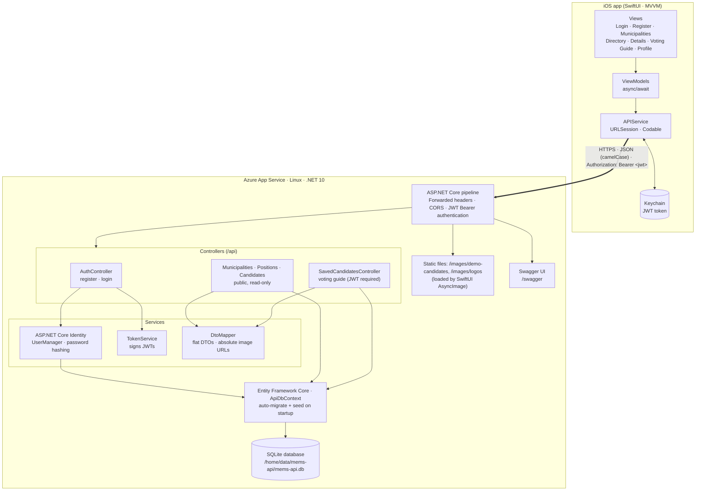
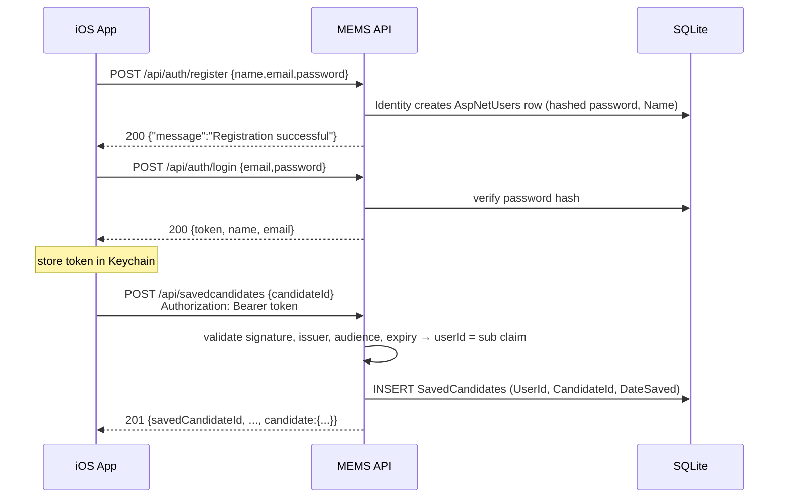
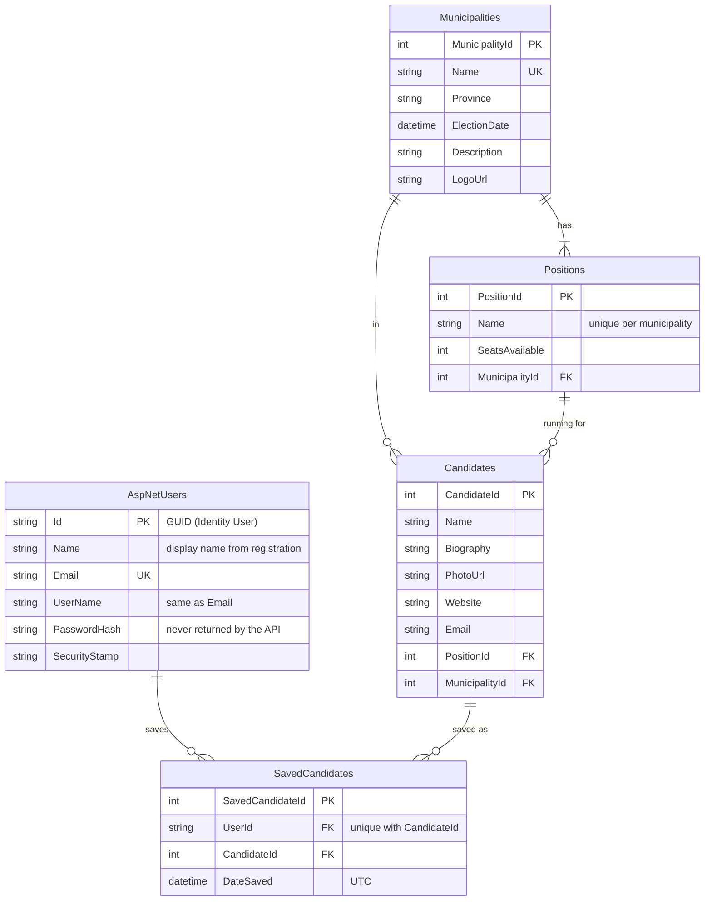

# COMP4977 Assignment 1 — Part 1: ASP.NET Core Web API

**Municipal Elections Companion API** — the backend for the SwiftUI app (Part 2).

| Item | Value |
| --- | --- |
| Project | `src/Mems.Api` (ASP.NET Core Web API, .NET 10) |
| Tests | `tests/Mems.Api.Tests` (xUnit integration tests, real HTTP pipeline + SQLite) |
| Data | EF Core 10 Code-First, SQLite, ASP.NET Core Identity |
| Auth | JWT Bearer (HMAC-SHA256), 7-day tokens |
| Docs UI | Swagger at `/swagger` (the site root `/` redirects there) |
| Azure API URL | https://mems-api-afisher-ane9a7cmfpb9b9at.canadacentral-01.azurewebsites.net (Swagger: `/swagger`) |
| GitHub repository | `https://github.com/AlexanderFisher-tech/MEMS-Assignment-1-main` |

### Why a separate project?

The COMP4976 MVC site (`src/Mems.Web`) is already deployed to Azure by `.github/workflows/main_mems-civic-guide-bcit.yml` and uses cookie auth, anti-forgery tokens and admin areas. Adding a stateless JWT API to it would have meant mixing two auth schemes and risking that deployment. `src/Mems.Api` is a clean, standalone Web API that **reuses** the MVC project's entity design, the 24 fictional candidates and biographies (`Data/DemoCandidates.cs`), and the candidate portraits (`wwwroot/images/demo-candidates`). It deploys as one App Service web app on its own and doesn't touch the MVC site.

Differences from the MVC data, which follow the COMP4977 spec:

- "Councilor" is spelled **Councillor**.
- Province is `BC`.
- `Candidate.Profile` is renamed **`Biography`**.
- Image file names become **`PhotoUrl` / `LogoUrl`**.
- `Candidate` gets the spec's `MunicipalityId` column.
- New PNG municipality logos are in `wwwroot/images/logos`. These are simple original crests, not official logos. They are PNG because SwiftUI's `AsyncImage` can't render SVG.

---

## 1. Architecture



### Login and voting-guide flow



### Request pipeline (Program.cs)

1. **ForwardedHeaders** — App Service terminates TLS, so the app trusts `X-Forwarded-Proto`. That makes generated image URLs `https://…`, which iOS App Transport Security requires.
2. **Exception handler** — returns `{ "message": "An unexpected server error occurred." }` with status 500.
3. **Static files** — `/images/demo-candidates/*.jpg` and `/images/logos/*.png`.
4. **Swagger** and **Swagger UI**.
5. **CORS** — `AllowAnyOrigin`, `AllowAnyMethod`, `AllowAnyHeader`.
6. **Authentication** (JWT Bearer) and **Authorization**.
7. **Controllers**.
8. **Startup**: `Database.MigrateAsync()` and then the idempotent seeder run before the first request. A brand-new App Service needs no manual `dotnet ef` commands.

---

## 2. Database ERD



The other Identity tables (`AspNetRoles`, `AspNetUserClaims`, `AspNetUserLogins`, `AspNetUserRoles`, `AspNetUserTokens`, `AspNetRoleClaims`) are created by `IdentityDbContext` but not used by the API.

**Delete rules:**

- Restrict on Municipality → Position → Candidate, so election data can't be deleted while other rows depend on it.
- Cascade on User/Candidate → SavedCandidate, so voting-guide entries disappear with their user or candidate.

**Seed data** (`Data/SeedData.cs`, runs only when the database is empty):

- **4 municipalities:** Pitt Meadows, Maple Ridge, Burnaby, Surrey. Each has `Province = "BC"`, `ElectionDate = 2026-10-17`, and a PNG logo.
- **12 positions:** each municipality has Mayor (1 seat), Councillor (6 seats) and School Trustee (2 seats).
- **24 fictional candidates:** two per position. Each has an 80–150 word biography, a portrait, a website (`https://example.org/candidates/<key>`) and an email (`first.last@example.org`).

---

## 3. API endpoints

All responses are JSON in camelCase. Every error, including validation failures, has the shape `{ "message": "…" }`. Image URLs are absolute and built from the request: `{scheme}://{host}/images/...`. Set the `App__PublicBaseUrl` setting to force a particular host.

| Method | Route | Auth | Success | Errors |
| --- | --- | --- | --- | --- |
| POST | `/api/auth/register` | public | 200 `{message}` | 400 `{message}` |
| POST | `/api/auth/login` | public | 200 `{token,name,email}` | 400, 401 `{message}` |
| GET | `/api/municipalities` | public | 200 `MunicipalityDto[]` | |
| GET | `/api/municipalities/{id}` | public | 200 `MunicipalityDto` | 404 |
| GET | `/api/positions[?municipalityId=]` | public | 200 `PositionDto[]` | |
| GET | `/api/positions/{id}` | public | 200 `PositionDto` | 404 |
| GET | `/api/candidates[?municipalityId=&positionId=]` | public | 200 `CandidateDto[]` | |
| GET | `/api/candidates/{id}` | public | 200 `CandidateDto` | 404 |
| GET | `/api/candidates/search?name={q}[&municipalityId=&positionId=]` | public | 200 `CandidateDto[]` | |
| GET | `/api/savedcandidates` | 🔒 Bearer | 200 `SavedCandidateDto[]` (newest first) | 401 |
| GET | `/api/savedcandidates/{id}` | 🔒 Bearer | 200 `SavedCandidateDto` | 401, 404 |
| POST | `/api/savedcandidates` | 🔒 Bearer | 201 `SavedCandidateDto` | 400, 401, 404, 409 |
| DELETE | `/api/savedcandidates/{id}` | 🔒 Bearer | 204 No Content | 401, 404 |

Notes:

- `search` does a case-insensitive partial match on the candidate name. If `name` is missing or empty, it returns every candidate.
- `municipalityId` and `positionId` are optional extra filters for the iOS directory screen.
- `DELETE /api/savedcandidates/{id}` first looks for one of the user's entries whose **SavedCandidateId** is `id`. If there isn't one, it looks for an entry whose **CandidateId** is `id`. That way the app can remove an entry using either ID.
- The saved-candidate endpoints only ever read or change the signed-in user's entries. The user ID comes from the token's `sub` claim.

### Sample requests and responses

These were captured from a local run. On Azure, the host part of the URLs becomes `https://<app>.azurewebsites.net`.

**`POST /api/auth/register`**

```json
// request
{ "name": "Jane Doe", "email": "jane@example.com", "password": "password123" }
// 200
{ "message": "Registration successful" }
// 400 (duplicate)
{ "message": "An account with this email already exists." }
// 400 (validation)
{ "message": "Enter a valid email address. Password must be at least 6 characters." }
```

**`POST /api/auth/login`**

```json
// request
{ "email": "jane@example.com", "password": "password123" }
// 200
{ "token": "eyJhbGciOiJIUzI1NiIsInR5cCI6IkpXVCJ9.eyJhdWQiOiJNZW1zSW9zQXBwIi…", "name": "Jane Doe", "email": "jane@example.com" }
// 401
{ "message": "Invalid email or password" }
```

The token's claims are `sub` (user ID), `email`, `name`, `jti`, `iss` (`MemsApi`), `aud` (`MemsIosApp`) and `exp` (7 days after login).

**`GET /api/municipalities`** (single item shown)

```json
[
  {
    "municipalityId": 3,
    "name": "Burnaby",
    "province": "BC",
    "electionDate": "2026-10-17T00:00:00",
    "description": "A large, diverse city at the centre of Metro Vancouver with busy town centres, parks, and post-secondary campuses. Sample election data for a student application.",
    "logoUrl": "https://localhost:5090/images/logos/burnaby.png"
  }
]
```

**`GET /api/positions/2`**

```json
{ "positionId": 2, "name": "Councillor", "seatsAvailable": 6, "municipalityId": 1, "municipalityName": "Pitt Meadows" }
```

**`GET /api/candidates/1`**

```json
{
  "candidateId": 1,
  "name": "Mara Ellison",
  "biography": "Mara Ellison is a fictional community planning consultant who has spent her imagined career …",
  "photoUrl": "https://localhost:5090/images/demo-candidates/demo-mara-ellison.jpg",
  "website": "https://example.org/candidates/mara-ellison",
  "email": "mara.ellison@example.org",
  "positionId": 1,
  "positionName": "Mayor",
  "municipalityId": 1,
  "municipalityName": "Pitt Meadows"
}
```

**`GET /api/candidates/search?name=AN`** returns an array of `CandidateDto`:

`Adrian Solano, Vivian Kessler, Mei Tanaka, Daniel Hwang, Priya Nand, Julian Mensah, Hassan Beaumont`

**`POST /api/savedcandidates`** (header `Authorization: Bearer <token>`)

```json
// request
{ "candidateId": 1 }
// 201 Created (Location: /api/savedcandidates/1)
{
  "savedCandidateId": 1,
  "userId": "6acded42-d8a2-4e18-bb30-2f499dee5df6",
  "candidateId": 1,
  "dateSaved": "2026-10-24T07:04:56Z",
  "candidate": {
    "candidateId": 1, "name": "Mara Ellison", "biography": "…",
    "photoUrl": "https://localhost:5090/images/demo-candidates/demo-mara-ellison.jpg",
    "website": "https://example.org/candidates/mara-ellison", "email": "mara.ellison@example.org",
    "positionId": 1, "positionName": "Mayor", "municipalityId": 1, "municipalityName": "Pitt Meadows"
  }
}
// 409 (already saved)
{ "message": "Candidate already in voting guide" }
// 404 (no such candidate)
{ "message": "Candidate not found" }
```

**`GET /api/savedcandidates`** returns an array of the objects above, newest first.

**`DELETE /api/savedcandidates/{id}`** returns `204 No Content`, or `404 {"message":"Saved candidate not found"}`.

**Any 🔒 endpoint called without a valid token**

```
HTTP/1.1 401 Unauthorized
WWW-Authenticate: Bearer
{ "message": "Authentication required. Send a valid bearer token." }
```

### Notes for the SwiftUI client (Part 2)

- Send `Authorization: Bearer \(token)` and `Content-Type: application/json` on protected calls.
- `dateSaved` is ISO 8601 UTC with whole seconds (`2026-10-24T07:04:56Z`), so `.iso8601` decodes it. `electionDate` follows the spec format `2026-10-17T00:00:00`, which has no time zone. Use a decoding strategy that accepts both formats:
  ```swift
  decoder.dateDecodingStrategy = .custom { d in
      let s = try d.singleValueContainer().decode(String.self)
      if let date = ISO8601DateFormatter().date(from: s) { return date }
      let f = DateFormatter(); f.locale = Locale(identifier: "en_US_POSIX"); f.dateFormat = "yyyy-MM-dd'T'HH:mm:ss"
      if let date = f.date(from: s) { return date }
      throw DecodingError.dataCorruptedError(in: try d.singleValueContainer(), debugDescription: "Bad date \(s)")
  }
  ```
- `photoUrl` and `logoUrl` are absolute `https` URLs on Azure, so `AsyncImage(url: URL(string: c.photoUrl ?? ""))` works directly.
- Treat any non-2xx response as an error and show the `message` field to the user.
- For the simulator against a local API, use `http://localhost:5080` and add an ATS exception for `localhost`. The deployed Azure URL is HTTPS-only.

---
